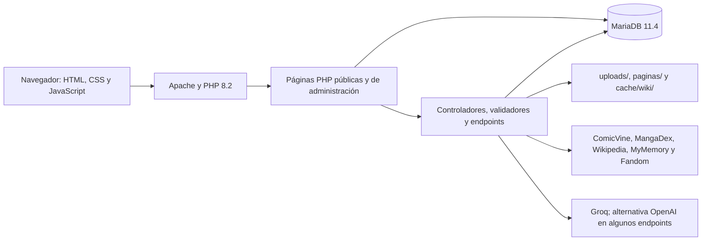
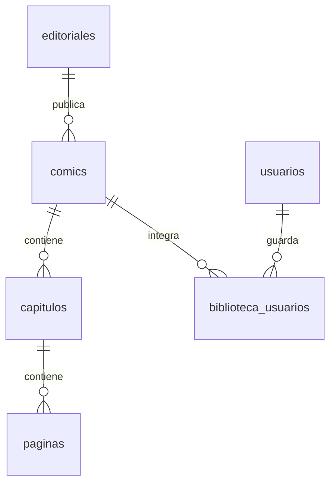

# Comic House: arquitectura y contexto de continuidad

Revisión: **15 de noviembre de 2026**, America/Bogota.

**Actualización de implementación:** las secciones 10 a 21 registran la continuación realizada
después del inventario inicial. Las observaciones de la sección 8 describen el estado
anterior a esos cambios; consultar la sección 21 para el estado más reciente.

Este documento conserva el mapa del proyecto y el contexto necesario para continuar el trabajo. Describe el código encontrado y separa las comprobaciones de esta revisión de los resultados que Claude documentó anteriormente. No sustituye la inspección del estado actual antes de hacer cambios.

## 1. Ubicación y fuentes revisadas

- Workspace: `C:\Users\juand\Documents\JUAN DIEGO\PROYECTOS\Comic House`.
- Aplicación y repositorio Git: subcarpeta `Comic-House/`.
- Historial de Claude: `C:\Users\juand\.claude\projects\c--Users-juand-Documents-JUAN-DIEGO-PROYECTOS-Comic-House\c37c077e-9dac-48b1-a19e-4863e9bbb42e.jsonl`.
- La carpeta `memory/` de ese proyecto de Claude **estaba vacía**. El contexto se recuperó del historial, sus resúmenes y los archivos del proyecto.
- Exportación de conversación en el workspace: `2026-11-15-112206-this-session-is-being-continued-from-a-previous-c.txt`. Su final muestra el intento de generalizar la búsqueda de tomos, interrumpido por el límite de uso de Claude.
- Referencias principales: [README](../README.md), [documentación del registro](../DOC_Automatizacion_Registro.md), [plan del registro](../PLAN_Registro_Automatizado.md), [plan de resumen y Próximamente](../PLAN_Resumen_y_Proximamente.md) y [plan de editoriales y capítulos](../PLAN_Editoriales_Capitulos_Registro.md).

Se inventariaron los archivos del proyecto y se revisaron sus fuentes PHP, JavaScript, CSS, SQL y Python, notebooks, documentos y datasets. Se extrajo texto de los siete PDF. Los archivos de imágenes, fuentes tipográficas y comprimidos se identificaron como recursos; no se interpretó visualmente cada página de los cómics. El JSONL se procesó completo para extraer el diálogo y localizar las decisiones, correcciones y resultados relevantes, sin copiar credenciales a este documento.

## 2. Arquitectura general

Comic House es una plataforma de catálogo, gestión y lectura de cómics y mangas. Es un **monolito PHP multipágina**, con HTML renderizado en el servidor y JavaScript que añade búsquedas, modales, propuestas de metadatos y subida con progreso.

La organización recuerda a MVC, pero no hay un framework MVC ni un router central: las páginas PHP también contienen consultas, presentación y lógica de interfaz. `modelo/` contiene la conexión; `controlador/` agrupa acciones, validadores, utilidades y endpoints. No se encontró manifiesto Composer, npm, framework de pruebas general ni proceso de compilación del frontend.



### Entorno y persistencia

| Elemento | Implementación |
|---|---|
| Servidor | Imagen `php:8.2-apache`, definida en [Dockerfile](../Dockerfile) |
| Servicios | `web` y `db` en [docker-compose.yml](../docker-compose.yml) |
| Contenedores | `comic_house_web` y `comic_house_db` |
| Acceso web previsto | `http://localhost:8080` |
| MariaDB | `mariadb:11.4`; puerto del anfitrión 3307, interno 3306 |
| Código | Montaje del directorio del proyecto en `/var/www/html` |
| Datos SQL | Volumen Docker `db_data` |
| Inicialización | `database/init/` se monta en `/docker-entrypoint-initdb.d` |
| Conexión | [modelo/conexion.php](../modelo/conexion.php): lector propio de `.env`, mysqli y `utf8mb4` |
| Extensiones y utilidades | mysqli, PDO/MySQL, ZIP, GD, unzip y unrar-free |
| Límites PHP | `php.ini`: subida, POST y memoria de 512 MB; tiempos de 300 segundos |
| Archivos generados | `uploads/`, `paginas/` y `cache/`, excluidos de Git |

El SQL de inicialización se aplica al crear un volumen nuevo; editarlo no migra automáticamente una base existente. Hay migraciones adicionales en `database/` y en la carpeta de benchmarks, sin un ejecutor de migraciones centralizado.

## 3. Mapa de módulos

| Ruta | Responsabilidad |
|---|---|
| [index.php](../index.php) | Inicio: Próximamente, slider, imprescindibles, catálogo y editoriales destacadas |
| [P-comics/p-comics.php](../P-comics/p-comics.php) | Catálogo con filtros por tipo, género y editorial |
| [Comics/comics.php](../Comics/comics.php) | Ficha, descripción, metadatos y capítulos de una obra |
| [Lector/lector.php](../Lector/lector.php) | Lectura vertical, páginas dobles, enlaces entre capítulos, ambiente y desplazamiento suave |
| [Biblioteca/index.php](../Biblioteca/index.php) | Colección personal del usuario autenticado |
| [Login/login.php](../Login/login.php), [Registro/registro.php](../Registro/registro.php), [logout.php](../logout.php) | Autenticación y sesiones |
| [dashboard.php](../dashboard.php) | Contadores y últimas cargas del panel |
| [crud.php](../crud.php) | Registro y listado de obras; orquestación del autocompletado y del modal |
| [modificar_comic.php](../modificar_comic.php) | Edición manual de la obra |
| [subir_capitulo.php](../subir_capitulo.php) | Selección de obra, formulario, capítulos subidos, tomos sugeridos y subida con progreso |
| [editar_capitulo.php](../editar_capitulo.php) | Edición de los datos de un capítulo |
| [destacar.php](../destacar.php) | Slider, fondos, logos y estado de publicación |
| [editoriales.php](../editoriales.php) | Alta, edición, logos, orden y selección de editoriales de portada |
| [auxiliar/codigo.php](../auxiliar/codigo.php) y [js/script.js](../js/script.js) | Buscador público por AJAX; devuelve fragmentos HTML |
| [admin/admin.css](../admin/admin.css) y [admin/cabecera.php](../admin/cabecera.php) | Base visual y cabecera compartida del panel |
| `Imagenes/`, `fonts/`, `assets/` | Recursos estáticos; Tailwind está en `assets/tailwind.js` |

### Identidad visual y dependencias

Montserrat, fondos oscuros y rojos `#ce4646` y `#ef4444`. El panel define variables de color, tipografía, botones, campos, avisos y listas en `admin/admin.css`, aunque varias páginas conservan estilos y scripts propios incrustados.

El frontend combina CSS propio, Tailwind local, Bootstrap Icons, jQuery, Swiper y otras dependencias cargadas desde CDN. El lector usa Lenis para el desplazamiento y una capa de imágenes desenfocadas para el ambiente. El ambiente comienza apagado salvo preferencia guardada en `localStorage`.

## 4. Modelo de datos

La aplicación persiste en MariaDB con InnoDB. Los notebooks académicos usan SQLite en memoria para demostraciones; SQLite no es la base de la aplicación.



| Tabla | Datos y reglas relevantes |
|---|---|
| `configuracion` | Una fila, `id=1`; formato de editoriales de portada de 5 o 10 espacios |
| `editoriales` | Nombre único, imagen, `destacada` y `orden_destacada`; triggers limitan las destacadas al formato elegido |
| `comics` | Título único, clasificación, descripción, año, género, portada, tipo, editorial, capítulos publicados y atributos de portada |
| `capitulos` | Obra, título, etiqueta `numero`, fecha, formato `grapa/rango/tomo`, `numero_desde`, `numero_hasta` y arco |
| `paginas` | Capítulo, ruta de imagen, orden y `es_doble`; posición única dentro del capítulo |
| `usuarios` | Email y usuario únicos, contraseña con hash y rol `admin/usuario` |
| `biblioteca_usuarios` | Relación única de usuario y cómic; referencia al nombre `usuarios.usuario` |

`comics.editorial_id` es la referencia a la editorial. También existe `comics.editorial` como texto redundante: al renombrar una editorial, la pantalla de editoriales sincroniza ese texto.

La FK de editorial usa `ON DELETE RESTRICT`. Las relaciones de cómics, capítulos, páginas y biblioteca usan cascadas SQL. Esas cascadas eliminan filas, no los archivos físicos asociados.

Los capítulos tienen unicidad por `(comic_id, numero)` y `(comic_id, numero_desde)`, restricciones de rangos y triggers de INSERT/UPDATE contra solapamientos. El índice `(capitulo_id, orden)` de páginas permite filtrar y ordenar. Hay índices por tipo, género y editorial, y por obra y numeración de capítulo.

**Distinción del dominio:** `comics.capitulos` describe lo publicado por la obra; las filas de `capitulos` representan entregas cargadas al sitio, que pueden agrupar varios episodios. Un tomo con rango no equivale a un capítulo suelto. El valor `tomo` del formato se usa para un recopilatorio; en manga, un tomo que agrupa episodios se guarda como `rango`.

## 5. Flujos principales

### Registro automatizado de una obra

1. El administrador escribe el título en `crud.php`. Tras 350 ms, se consulta `buscar_metadatos.php`.
2. ComicVine devuelve hasta ocho candidatos. Se ordenan por coincidencia del título y una heurística de editorial, número de entregas y año. La edición recomendada aparece primero; el administrador elige cuál abrir.
3. El modal reúne datos en paralelo: traducción, descarga de portada y clasificación/género. La sinopsis traducida puede pasar después por el resumen generativo.
4. Clasificación: MangaDex con coincidencia de título y año; si no resuelve, reglas sobre Wikipedia y modelo opcional. El tipo se sugiere por editorial; el género usa etiquetas, palabras clave o modelo.
5. Si falta la editorial local, se ofrece crear la editorial real. El administrador revisa y confirma las propuestas.
6. Se rellenan los campos editables. Guardar el formulario llama a `controlador/registro_comcis.php` — ese nombre está escrito así en el proyecto.

| Endpoint | Función |
|---|---|
| `buscar_metadatos.php` | Búsqueda ComicVine, candidatos, erratas, editorial local y aviso de título existente |
| `buscar_clasificacion.php` | MangaDex: clasificación y género con contraste de título/año |
| `estimar_clasificacion.php` | Wikipedia y estimación de clasificación/género |
| `traducir.php` | MyMemory EN→ES, bloques de hasta 450 caracteres, máximo cuatro |
| `resumir_descripcion.php` | Resume textos de más de 450 caracteres; acepta hasta 500 con validaciones y conserva el original |
| `descargar_portada.php` | Descarga una imagen de la fuente, valida formato y tamaño y la guarda en `uploads/`; requiere admin |
| `crear_editorial.php` | Crea o reutiliza una editorial desde el registro; requiere admin |
| `miniaturas.php` | Utilidades GD para miniaturas de 400/800 px y `srcset`; se generan bajo demanda |

Las claves se configuran en `.env`. ComicVine usa `COMICVINE_API_KEY`. Groq es opcional con `GROQ_API_KEY`; estimación y resumen tienen alternativa con `OPENAI_API_KEY`. Los nombres de modelo codificados son configuración existente, no una comprobación de disponibilidad actual.

El estado de publicación se deduce de los números devueltos por ComicVine: es una heurística, no un estado oficial publicado por la fuente. Las marcas de procedencia del modal distinguen propuestas verificadas y estimadas, pero no existe una tabla general que persista toda esa procedencia.

### Subida de capítulos y tomos

1. `subir_capitulo.php` selecciona una obra y consulta los capítulos cargados con `get_capitulos.php`.
2. Consulta dos fuentes complementarias: `buscar_capitulos_wiki.php` para títulos y `buscar_tomos_wiki.php` para tomos, rangos, arcos y fechas.
3. La interfaz permite elegir un tomo pendiente o introducir los datos. El nombre del CBR/CBZ puede proponer numeración. Las propuestas respetan los campos escritos a mano.
4. El envío usa `XMLHttpRequest` y `FormData`, con progreso de transmisión y estado de procesamiento.
5. `procesar_capitulo.php` valida sesión admin, obra, fecha y numeración con `validar_capitulo.php`. Si el nombre parece de otra obra, pide confirmación mediante el modal propio.
6. Inserta el capítulo, crea `paginas/cap_<id>/` y extrae las imágenes: CBZ con `ZipArchive`, CBR con unrar-free/unrar.
7. Ordena imágenes, detecta página doble si el ancho supera al alto e inserta páginas en lotes de 100 dentro de una transacción.
8. Devuelve JSON y la interfaz recarga con la obra seleccionada.

La transacción cubre la inserción de páginas; el capítulo se inserta antes y se intenta eliminar si falla esa fase. No hay una transacción única que incluya extracción, archivos físicos y todas las escrituras.

### Fandom y caché

Fandom se consulta mediante MediaWiki sin clave. Cada comunidad tiene una estructura propia: índices, categorías, plantillas `volinfo` o fichas por número. Los resultados son sugerencias revisables y, si no hay datos, el formulario admite entrada manual.

Los dos endpoints guardan respuestas aprovechables durante siete días en `cache/wiki/`. Esta caché pertenece a la búsqueda de capítulos/tomos; el registro de ComicVine no tiene una caché equivalente.

Para Berserk se identificó el reinicio de numeración entre prólogo y serie normal. El parser actual agrupa por serie y toma la que tiene más episodios en el tomo. Es una aproximación con pérdida: la persistencia solo guarda un rango entero, sin identidad de serie de numeración.

### Catálogo, lectura, biblioteca y sesiones

- En `index.php`, una obra sin capítulos pasa a Próximamente mediante `NOT EXISTS`. Se presenta antes del catálogo, atenuada y sin enlace. Slider e imprescindibles requieren capítulos disponibles. El catálogo filtrado de `P-comics/` conserva su propia consulta.
- La ficha consulta la obra y sus capítulos; maneja la ausencia de capítulos para evitar enlaces vacíos.
- El lector obtiene las páginas de un capítulo y los capítulos anterior/siguiente. Actualmente ordena páginas y navegación por `id`; no usa en todas esas consultas el orden estructurado descrito por los benchmarks.
- El registro de usuario usa `password_hash`; el login usa `password_verify`. La sesión guarda id, email, usuario y rol. El panel comprueba el rol admin.
- La biblioteca consulta la relación por `usuario`; `agregar_a_biblioteca.php` evita repetir una obra y devuelve estados de texto.

## 6. Trabajo académico

`E1_integridad_rendimiento/` contiene un recorrido de datos y rendimiento conectado al proyecto:

- `dataset_sucio/`: CSV de cómics con defectos y registro de defectos inyectados.
- `dataset_limpio/`: cuatro filas válidas y siete rechazadas por dominio; dos duplicados se separaron antes. Reconciliación: 13 iniciales − 2 duplicados − 7 inválidas = 4 válidas.
- Notebook E1: diagnóstico, normalización, rechazo de datos sin evidencia, restricciones y transacciones en SQLite, índices sobre 250.000 páginas sintéticas y consultas del dominio.
- `benchmark/`: inserción individual frente a lotes, umbral de uso de índices, escalado, orden inverso y validación de operaciones/editoriales/capítulos.
- `benchmark/antes/procesar_capitulo.ANTES.php`: implementación histórica para comparar.
- `presentacion/`: exposición con diseño de Comic House y acciones reales permitidas por clave en `ejecutar.php`. Combina SQL, scripts PHP, CSV y un diff previamente guardado; no es una terminal libre del anfitrión.
- `scripts/`: generación del dataset, notebook e informes con Python y ReportLab.

Los informes históricos registran 206,47 ms frente a 2,92 ms para insertar 220 páginas y 75 ms frente a 0,47 ms para una lectura a escala. Son mediciones de SQL documentadas anteriormente, **no mediciones nuevas ni tiempos completos de subida y extracción**.

Los materiales S04, las guías del docente y el laboratorio de Wireshark acompañan el trabajo académico; no son servicios de ejecución de Comic House. Los exports de base de datos están excluidos de Git y no estaban presentes en el inventario actual; algunos scripts/notebooks los necesitan para regenerar sus resultados.

## 7. Historia y preferencias que conviene conservar

El historial cubre el arranque con Docker, exportación de datos, trabajo E1, optimización de cargas, presentación, documentación académica y automatización del registro y de capítulos.

Decisiones expresadas por el usuario y correcciones relevantes:

- Mantener el diseño real de Comic House, su tipografía y sus colores. El usuario rechazó interfaces inventadas, azul ajeno al sitio y scrolls que rompían su estética.
- Explicar en español y con lenguaje natural; para exposiciones, redactar pensando en el público y en tercera persona.
- Para funcionalidades amplias, planificar en Markdown mediante historias de usuario, criterios de aceptación y fases, y comprobar cada fase.
- Buscar mientras se escribe; mostrar las ediciones antes de abrir el modal; permitir revisión y confirmación.
- No asignar una editorial distinta para completar un campo faltante: crear la correcta.
- Distinguir estimaciones de IA de datos obtenidos de fuentes. Conservar alternativas manuales ante fallos externos.
- Mostrar progreso y avisos con los componentes de la aplicación. Respetar el trabajo manual al aplicar propuestas automáticas.
- Gestionar tomos con sus rangos, títulos/arcos y fechas; no asumir que todos los archivos contienen un único capítulo.
- El usuario pidió que la búsqueda sirviera para todas las obras, no únicamente Berserk. Eso es el objetivo pendiente más reciente, no un resultado ya alcanzado.

## 8. Estado encontrado y continuidad

### Git, documentación y entorno

- Rama `main`, HEAD `88c0870` (`Tomos: el arco es el titulo, traducido, y lista desplegable`).
- Frente al seguimiento local de `origin/main`, la rama figuraba 41 commits por delante. No se hizo `fetch`; eso no verifica el estado remoto actual.
- Había **un cambio previo sin commit** en `controlador/buscar_tomos_wiki.php`: 171 inserciones y 9 eliminaciones según `git diff --stat`.
- El plan de registro figura cerrado con 47 criterios, y el de resumen/Próximamente con 25. Esos cierres son estados documentales históricos; esta revisión no volvió a ejecutar sus pruebas.
- El plan de editoriales/capítulos sigue abierto. Algunos textos de la documentación del registro quedaron anteriores a los cambios posteriores de subida y caché.
- `docker compose ps` falló porque no estaba disponible el motor Docker Desktop Linux. No se inició Docker ni se modificó la base; no se pudo comparar el esquema de una base viva ni comprobar la interfaz autenticada.

### Punto exacto donde quedó Claude

El cambio sin commit añade wikis por editorial y búsqueda de números occidentales, además del parser de tomos de manga. El historial llegó a reportar cobertura de cinco de siete obras, pero descubrió que Ultimate Spider-Man mezclaba encarnaciones de 2000 y 2024. El intento de filtrarlas quedó interrumpido. Esa cifra es un resultado histórico parcial, no una garantía actual.

La inspección del código permite concretar estos pendientes de integración:

1. `buscar_tomos_wiki.php` recibe `editorial` y `anio`, pero `subir_capitulo.php` solo le envía `titulo`; su consulta inicial tampoco trae editorial ni año.
2. La clave de caché de tomos solo depende del título. No distingue editorial, año o encarnación de la serie.
3. `numerosSueltos()` indexa los títulos por número antes de leer sus fechas. Dos encarnaciones con el mismo número pueden sobrescribirse antes del filtro posterior. La ventana de ±25 años tampoco identifica una encarnación de forma inequívoca.
4. Los números occidentales devueltos por esa estrategia traen el arco vacío; los títulos proceden de otro endpoint. Hace falta verificar la combinación completa para cada obra.
5. La interfaz debe coordinar la llegada de capítulos cargados y tomos sugeridos para calcular pendientes con la información correcta; hoy las peticiones son independientes.

Estas observaciones se basan en lectura estática. No se corrigieron durante esta revisión.

### Otros pendientes confirmados por plan o código

| Área | Pendiente |
|---|---|
| Subida | Rechazar archivos corruptos, no admitidos o sin imágenes antes de aceptar un capítulo; hoy puede terminar con cero páginas |
| Avisos | `revisarCapitulo()` devuelve `aviso` al superar el total publicado, pero el procesador solo trata `error` y no comunica ese aviso |
| Cargas múltiples | Selección de varios archivos, revisión individual y resultados por archivo |
| Reintentos y reemplazo | Reanudación tras fallo parcial y reemplazo explícito con limpieza de páginas anteriores |
| Archivos físicos | Limpieza coherente ante errores y borrados; las cascadas SQL no borran carpetas |
| Editoriales | Búsqueda automática de logos y consolidación de la validación/reutilización entre los flujos de alta |
| Alta desde modal | `crearEditorial()` añade una opción con valor id, mientras el formulario y `rellenar()` buscan el nombre de editorial; revisar esta incoherencia antes de dar el flujo por validado |
| Edición | `actualizar_capitulo.php` actualiza el texto `numero` pero no el rango/formato/arco; `modificar.php` mantiene SQL concatenado y no sincroniza todos los campos estructurados |
| Lector y listados | Unificar orden numérico estructurado; varias consultas siguen ordenando por texto o por id |

### Diferencias entre esquema inicial y código actual

El [SQL inicial](../database/init/01_schema.sql) no contiene `comics.capitulo_desde`, `comics.capitulo_hasta` ni el valor `Tomo unico` del ENUM de publicación. El controlador de registro sí los usa. Esas ampliaciones están en [momento2_registro_comic.sql](../E1_integridad_rendimiento/benchmark/momento2_registro_comic.sql), fuera del directorio que Docker inicializa automáticamente.

Por tanto, el arranque sobre un volumen vacío necesita revisar la incorporación de esas ampliaciones al esquema inicial. No ejecutar todos los SQL antiguos en bloque: varios `ALTER TABLE`, índices y triggers ya están presentes en `01_schema.sql`, y las migraciones no son uniformemente repetibles. El CHECK de año del esquema está fijado en 2026, mientras el controlador usa un límite calculado con `date('Y') + 1`.

## 9. Cómo retomar el trabajo

1. Leer la petición actual y consultar `git status` y el diff antes de editar. No convertir automáticamente todos los pendientes históricos en trabajo autorizado.
2. Usar este mapa para localizar el módulo y contrastarlo con el código vigente.
3. Si se necesita ejecución, comprobar Docker y revisar el esquema aplicado antes de migrar. El historial menciona conflictos ocasionales de 8080 con otro proyecto; no detener servicios ajenos por suposición.
4. Para retomar la última funcionalidad, empezar por la identificación de obra/edición, los parámetros de la interfaz y la caché de Fandom; verificar después títulos, rangos y fechas en el flujo completo.
5. Elegir los scripts existentes adecuados y revisar sus supuestos antes de ejecutarlos: algunos dependen de ids/datos de ejemplo o de columnas anteriores. Registrar evidencia nueva como nueva y conservar las mediciones históricas identificadas como tales.

Comandos de referencia, desde la raíz del repositorio:

```powershell
git status --short
git diff -- controlador/buscar_tomos_wiki.php
docker compose ps
```

Con Docker ya disponible y el esquema comprobado, la guía de pruebas y benchmarks está en [CHEATSHEET.md](../E1_integridad_rendimiento/CHEATSHEET.md). Durante esta revisión solo se añadieron documentos de contexto; el código de la aplicación y el cambio previo de Claude se conservaron.

## 10. Continuación implementada el 15 de noviembre de 2026

El usuario pidió seguir desde el último mensaje de Claude conforme al plan vigente.
Se completó la ampliación de HU-B1/HU-B2: búsqueda de entregas para las siete obras
del catálogo, identidad de edición y protección contra respuestas atrasadas.

- [buscar_tomos_wiki.php](../controlador/buscar_tomos_wiki.php) coordina la búsqueda y
  la caché. Los parsers y las fuentes están en [tomos_fuentes.php](../controlador/tomos_fuentes.php).
- Se usa el wiki de la obra/editorial para tomos, números de una serie identificada
  y libros únicos. ComicVine respalda las obras sin una lista utilizable en Fandom.
- El formulario envía título, tipo, estado, año y editorial. La caché distingue también
  la edición elegida y tiene versión propia para no reutilizar los resultados anteriores.
- Ultimate Spiderman figura como 1980 en el catálogo; se pide elegir entre las series
  de 2000, 2009 y 2024. Bloodborne requiere elegir entre las ediciones encontradas,
  porque ninguna corresponde inequívocamente a la editorial Norma registrada localmente.
  No se modificaron esos registros.
- [js/tomos.js](../js/tomos.js) gestiona selección, propuestas, pendientes y respuestas
  atrasadas. Se conservan los campos escritos a mano y se recalculan los pendientes
  cuando llegan los capítulos cargados. El formulario sigue disponible si falla una fuente.
- Mes/año se muestra como tal: solo se rellena la fecha completa cuando hay un día publicado.
  Las fechas existentes se muestran sin la conversión a UTC que podía restar un día.
- Berserk conserva todos los episodios al reiniciar su numeración: se propone una
  secuencia continua y se muestra la notación original. Tomo 5: 15–22, correspondiente
  a `0-15…0-16, 1…6`; tomo 6: 23–32. Los tres capítulos existentes no cambiaron.

Docker Desktop se inició y los dos contenedores de Comic House quedaron disponibles
en el puerto 8080. No se hicieron migraciones ni cambios en las filas de la base.
Se verificaron **28 casos PHP y 18 casos en Edge**, además de sintaxis PHP/JavaScript
y revisión del diff. El catálogo conserva 7 obras, 9 capítulos y 930 páginas.

Pruebas: [tests/tomos_fuentes.php](../tests/tomos_fuentes.php) y
[tests/tomos_ui.py](../tests/tomos_ui.py). La prueba de navegador usa una sesión
efímera, la destruye al terminar y no envía archivos. Consulta el catálogo de esta
revisión; algunos casos simulan respuestas fuera de orden y fallo de la fuente.

El [plan de editoriales y capítulos](../PLAN_Editoriales_Capitulos_Registro.md) contiene
los resultados por obra, los nuevos criterios y sus límites. No se cerró el plan completo:
el siguiente bloque es completar Sprint 4 (aviso fuera de rango y rechazo de archivos
inválidos), seguido de subida múltiple, reanudación/reemplazo y editoriales. Los pendientes
ajenos a esta ampliación descritos en la sección 8 continúan abiertos.

## 11. Fechas mensuales y controles personalizados

Se atendió la revisión del usuario: aceptar fechas sin día, personalizar los select
y sus opciones y ocultar las filas sin título. HU-B6 y HU-B7 del plan registran los
once criterios completados y su evidencia.

- `capitulos.fecha_publicacion_mes` guarda `YYYY-MM`; la columna DATE anterior
  sigue guardando fechas completas. Ambas pueden ser nulas; nunca ambas informadas.
  CHECKs validan la exclusión y el formato mensual. La migración 02 está aplicada
  en la base local y sus columnas/restricciones están en el esquema de inicialización.
- Subida, edición, lista de capítulos y ficha pública conservan esa precisión.
  La validación común está en `controlador/fecha_capitulo.php`; la interfaz usa
  `js/fechas-capitulo.js`. Las fechas anteriores no se convierten ni cambian.
- `js/select-personalizado.js` y `admin/controles.css` mejoran los select de edición,
  numeración y precisión. Conservan los valores de formulario y eventos change,
  con opciones propias, controles de teclado y barras oscuras/rojas. Se corrigió
  la cascada CSS que mantenía dos columnas estrechas en móvil.
- Las listas solo muestran entregas con título/arco. Las fechas de entregas sin
  nombre siguen disponibles al indicar el número a mano. Saga tiene seis títulos
  aprovechables en la fuente revisada; se omiten las demás filas.
- Se comprobó la búsqueda con Invincible, no registrado en la base: devolvió 144
  números sin añadir código específico. La cobertura de obras futuras depende de
  que las fuentes publiquen información identificable.

Verificación: 28 casos PHP de fuentes, 20 de fechas con validación y rollback en
MariaDB y 29 comprobaciones en Edge. Estas últimas incluyen una subida real de CBZ
y edición/ficha pública usando registros temporales; se limpian registros y carpeta
al finalizar. El catálogo original conserva 7 obras, 9 capítulos y 930 páginas.

Archivos clave adicionales: `database/migracion_02_fechas_parciales.sql` y
`tests/fechas_capitulo.php`. Las instalaciones existentes deben aplicar esa migración.
No se han cerrado los pendientes del Sprint 4 y siguientes.

## 12. Pulido de la colocación y de las sugerencias

El usuario pidió resolver el frontend antes de continuar con los otros sprints.
El campo de fecha integra valor y precisión en una sola caja alineada con el título,
tanto en subida como en edición. El select puede usar `data-resumen` para su etiqueta
compacta y un menú de ancho independiente sin cambiar el valor enviado.

`js/tomos.js` muestra «Capítulo 4» para una entrega individual y conserva los rangos
reales («Capítulos 10–14»). Las filas individuales omiten el rango redundante. La
leyenda usa un bloque gris con fecha y fuente, sin «se rellenó…»; la selección de
la fila se marca de manera discreta. Los errores reales de fecha siguen en rojo.

B7.6–B7.8 están marcados y documentados en el plan. Se revisó el resultado en Edge
a 1440, 1366 y 390 px, incluyendo las dos precisiones de fecha, menú sin recortes,
caso individual y rango real. No se modificó la lógica del servidor ni se hicieron
escrituras en la base durante esta revisión. El siguiente bloque pendiente del
plan sigue siendo Sprint 4.

## 13. Sprint 4 · comprobaciones de subida

CA-B3.4 y CA-B3.5 están completados y marcados en el plan. El próximo bloque es
Sprint 5 (HU-B4, subida múltiple y reanudación CA-B5.3).

- `validar_capitulo.php` considera inicio y final publicados; el texto de un
  rango abierto no se interpreta como un total de un capítulo. Fuera de rango
  responde `fuera_rango` hasta recibir `confirmar_rango=1`.
- `subir_capitulo.php` reutiliza su modal con título y explicación específicos.
  Conserva por separado `confirmar_rango` y `confirmar_obra`; cancelar mantiene
  el formulario. Evita envíos simultáneos y reinicia el progreso al reintentar.
- `archivo_capitulo.php` comprueba firmas ZIP/RAR, integridad, páginas reales
  y su decodificación con GD antes de crear el capítulo. Admite JPG/PNG/GIF/WebP,
  hasta 64 MB y 40 megapíxeles por imagen. Ignora metadatos, ordena las rutas
  originales de forma natural y genera nombres secuenciales al publicarlas.
- Los temporales están fuera de la carpeta pública. La transacción de
  `procesar_capitulo.php` incluye capítulo y páginas; mantiene los lotes de 100.
  Rollback y limpieza de carpetas cubren rechazos y fallos al guardar.
- Docker instala UnRAR del componente non-free de Debian. Se detectó mediante
  una prueba que `unrar-free 0.3.1` aceptaba un RAR con CRC de imagen incorrecto.
  El README explica la dependencia y la reconstrucción de la imagen.

`python tests/subida_capitulo.py`: 45 comprobaciones, con CBR/CBZ construidos
para la prueba, subidas HTTP reales y los modales en Edge. Incluye un fallo
provocado mediante un trigger temporal limitado al cómic de prueba y verifica
rollback, limpieza y reintento. Destruye sus sesiones y registros y elimina sus
carpetas. Las pruebas existentes también pasan: 28 de fuentes, 20 de fechas y
29 de interfaz. Se conserva el catálogo de 7 obras, 9 capítulos y 930 páginas.

La imagen PNG mínima del fixture anterior de `tests/tomos_ui.py` tenía una
cabecera reconocible pero datos inválidos para GD; se reemplazó por un PNG
real sin debilitar la comprobación de imágenes.

## 14. Sprint 5 · subida múltiple y reanudación

HU-B4 completa (CA-B4.1–B4.4) y CA-B5.3 marcado. El siguiente sprint del plan
es el 6: HU-C1/HU-C2, logos y reutilización de editoriales. Siguen pendientes
el reemplazo explícito CA-B5.4, HU-A2 por completar/verificar y el cierre documental.

- `subir_capitulo.php` conserva la subida individual y admite múltiples archivos.
  `js/lote-capitulos.js` mantiene una cola por obra, hasta 200 archivos, y reutiliza
  el formulario como editor de la fila elegida. El estilo está en
  `admin/lote-capitulos.css` y respeta los controles y colores existentes.
- `revisar_lote_capitulos.php` revisa solo metadatos, exige rol admin y no escribe
  registros ni archivos. Comparte `validar_capitulo.php` y `fecha_capitulo.php`.
  La interfaz agrega comprobaciones de solape entre archivos del mismo lote.
- Los campos manuales se conservan entre filas y al llegar fuentes nuevas.
  Los tomos de manga pueden proponer su rango mediante la edición seleccionada.
  Los eventos `entregas-actualizadas` y `entrega-elegida` sincronizan el editor
  y la lista. Los fallos de una fuente dejan disponibles los campos manuales.
- Se envía un archivo por petición, de forma secuencial, a `procesar_capitulo.php`.
  Los errores se quedan en su fila, los éxitos se conservan y los demás archivos
  continúan. Cancelar una confirmación pausa el lote antes de enviar esa entrega.
- `recibo_subida.php` comprueba intentos anteriores por clave y datos. La subida
  verifica además el SHA-256 al repetir un intento con archivo. Esta comprobación
  sucede antes de rechazar el rango como duplicado; no permite cambiar contenido
  ni datos de un capítulo guardado, ni reemplaza por coincidencia de nombre.
- `database/migracion_03_subida_lotes.sql` está aplicada. Añade las columnas
  opcionales `subida_clave` (única) y `archivo_sha256`; el esquema inicial también
  las incluye. Los nueve capítulos originales conservan sus datos.
- `sessionStorage` guarda el manifiesto de cada obra en la pestaña; no guarda
  bytes de archivos. Al recargar, consulta los recibos y solicita volver a elegir
  únicamente los archivos pendientes. Se limpia al cerrar/vaciar el lote.
- `get_capitulos.php` ordena por numeración estructurada, evitando 1,10,11,2.
  Los recopilatorios también revisan duplicados antes de subir. El select propio
  ignora eventos de scroll anteriores al clic cuando su campo no se ha movido.

`python tests/lote_capitulos.py`: **33 comprobaciones**, con cómic, CBR/CBZ,
sesión y páginas temporales. Prueba doce entregas con la cuarta corrupta y
pérdida de la respuesta de la séptima después del commit; reconoce once éxitos,
recarga el lote y envía únicamente la cuarta tras corregirla. Verifica también
recibos, cambios manuales, fechas parciales, avisos, cancelación, rangos de manga,
autenticación y móvil. Limpia sus registros y carpetas al terminar.

Pasan las 122 comprobaciones anteriores: total **155**. El catálogo original
conserva **7 obras, 9 capítulos y 930 páginas**. No se ha implementado el Sprint 6.

## 15. Registro · validación después de confirmar metadatos

Se corrigió el bloqueo reportado con Invincible: el modal completaba los datos
por asignación de `.value`, sin disparar los eventos que actualizan el aviso y
el botón. `rellenar()` en `crud.php` emite ahora un `change` del formulario al
terminar de aplicar todos los datos. La regla `.aviso-faltan[hidden]` evita que
su `display:flex` mantenga visible una caja roja cuando ya no falta nada.

CA-A1.6 del plan registra la corrección. `python tests/registro_validacion_ui.py`
pasa **10 comprobaciones** en Edge con respuestas de fuentes simuladas y el
formulario real: confirmación completa, editorial sin resolver, corrección manual,
valores de envío, ausencia de errores JavaScript y conservación del catálogo.
No envía altas ni descarga portadas. No se alteró la validación del servidor.
El próximo sprint sigue siendo el 6; esta entrega solo corrige el registro.

## 16. Invincible · grapas agrupadas y números sin título

El usuario cambió expresamente su preferencia: ahora se muestran **todos los
números**, con «Sin título publicado» cuando corresponda. La fuente de Invincible
contiene 144 números, pero solo 46 tienen título; los ocho primeros se ocultaban
por la preferencia anterior. CA-B7.4 del plan se actualizó para reflejar la decisión.

- `tomoDe()` en `js/tomos.js` combina grapas consecutivas para resolver archivos
  como `Invencible #1-2.cbr`, manteniendo 1–2. No combina huecos ni fragmentos de
  tomos de manga. Conserva los títulos publicados o propone un nombre descriptivo
  expresamente identificado si faltan o exceden el límite del campo.
- Se indica que la fecha propuesta es la del primer número del archivo. Ambas
  filas incluidas se marcan. `js/lote-capitulos.js` usa la misma resolución y
  conserva los datos manuales; para fechas completas deja vacío el campo mensual.
- `fechaDeNumero()` lee el campo `Day` además de `Month/Year`. La caché de
  entregas se versionó a v6 para renovar las fechas. Si el día no es válido,
  conserva solo el mes conocido. Los números #1 y #2 de Invincible tienen
  fechas 22/01/2003 y 19/02/2003 en las fichas consultadas.
- `buscar_metadatos.php` usa el número de `last_issue`, no la cantidad de
  fichas, como extremo final. Invincible tiene 145 fichas contando el #0,
  pero la numeración principal termina en #144. Se corrigió solo su fila
  local id 157 de 1–145 a 1–144 mediante una actualización condicionada.
  No se modificaron capítulos ni archivos del usuario.

`python tests/rangos_grapas_ui.py`: 24 comprobaciones, sin subidas ni escrituras,
con la fuente real y fixtures en memoria. Prueba también el autocompletado del
límite final, nombres descriptivos, selección individual y múltiple, fechas,
huecos, rangos de manga, edición pendiente y móvil. La prueba de fuentes suma
ahora 31 casos; `tomos_ui.py` contempla las filas sin título y el tamaño actual
del catálogo, que ya incluye Invincible.

Pasan 192 comprobaciones en las siete suites. Quedan 8 obras, 9 capítulos y
930 páginas, con el rango de Invincible corregido. El siguiente sprint sigue
siendo el 6; no se ha adelantado la automatización de editoriales.

## 17. Sprint 6 · logos, identidad editorial y HU-A2

Completos HU-C1/HU-C2 y HU-A2: sus **13 criterios** están marcados en el plan
con evidencia. Quedan CA-B5.4 (reemplazo explícito de capítulos) y el cierre
documental del Sprint 7. No se modificaron capítulos en esta entrega.

- `controlador/editorial_servicio.php` comparte consulta y alta entre la API
  `crear_editorial.php` y el formulario clásico de `editoriales.php`.
  `validar_editorial.php` compara mayúsculas, tildes, espacios y alias conocidos;
  mantiene nombres no latinos y trata las semejanzas como revisión, no identidad.
  `GET_LOCK('comic_house_editoriales',10)` serializa altas y cambios de nombre.
  Las altas repetidas reutilizan el id sin sobrescribir el logo existente.
- `buscar_logo_editorial.php` exige admin y no escribe registros: devuelve
  identidad, sugerencia y candidatos. La caché `logos_v1_<sha>.json` de un día
  está en `cache/wiki/`. La búsqueda lee P154 de Wikidata o el campo logo de
  Wikipedia; no usa `pageimages`, que puede ser una fotografía de la sede.
- `logo_editorial.php` comprueba HTTPS y los hosts exactos `upload.wikimedia.org`
  y `thumb.wikimedia.org` en cada redirección; limita la transferencia y valida
  imágenes PNG/JPEG/WebP/GIF de hasta 5 MB/16 megapíxeles. Las decodifica con GD
  y guarda PNG con nombre aleatorio. Los SVG remotos requieren su miniatura PNG;
  los SVG previos se conservan, pero no se aceptan nuevos SVG crudos.
- `js/editoriales-asistente.js` y `admin/editoriales-asistente.css` aportan
  propuestas revisables, enlace de fuente, rechazo y subida manual. El diálogo
  del registro permite crear sin logo y completarlo después; el catálogo exige
  imagen. Un nombre conocido por la fuente queda fijado; si falta se escribe.
  La opción del registro usa el nombre como `value` y el id en `data-id`.
  No se repintan las decisiones de género y clasificación al crear la editorial.
- Las búsquedas tardías se descartan y Escape cierra solo el diálogo editorial,
  conservando el candidato de metadatos. Las altas fallidas retiran el PNG nuevo.
  La edición valida también la imagen y sincroniza el nombre en cómics dentro
  de una transacción. No borra logos anteriores del usuario.

Pasan **32 pruebas PHP**, **42 de API/navegador** y las **10 de regresión del
registro**. Kodansha se consulta y descarga realmente; para marcas temporales se
simulan las propuestas, manteniendo el guardado real. Hay pruebas de concurrencia,
fallo SQL, autenticación, duplicados, validación, HU-A2, escritorio y móvil.
Los fixtures y sus logos/sesiones se limpian. No se requieren migraciones ni
variables nuevas. Se conserva el catálogo de **8 obras, 9 capítulos, 930 páginas**
y las editoriales originales. Las suites ajenas a este cambio no se repitieron.

## 18. Títulos ausentes · nombre del recopilatorio autorizado

El usuario reportó de nuevo la falta de título en `Invencible #1-2.cbr` y eligió
expresamente utilizar el nombre del recopilatorio cuando la fuente confirme su
contenido. Las fichas #1/#2 tienen `StoryTitle1` vacío; no era una regresión del
sprint de editoriales. Se amplió la propuesta sin inventar un título individual.

- `controlador/recopilatorios_fuentes.php` consulta Wikipedia para una obra y
  contrasta título y año de inicio con su ficha. El parser requiere tabla de
  recopilatorios, nombre y rango continuo explícitos; descarta celdas combinadas,
  contenido discontinuo, rangos invertidos y coincidencias ambiguas.
- `buscar_tomos_wiki.php` consulta este complemento solo cuando hay grapas sin
  título/arco. Mantiene el título individual vacío y adjunta `recopilatorio`
  con nombre, números incluidos, fuente y URL. Traduce opcionalmente con la misma
  función existente, conservando el original. La caché pasa de v6 a **v7**.
- `tomoDe()` propone el recopilatorio y el rango real del archivo. `#1-2` queda
  como «Asuntos familiares · números 1–2» en la consulta real. La leyenda aclara
  que el nombre proviene del recopilatorio #1–4 y que su traducción es orientativa.
  Los títulos individuales y cambios manuales conservan prioridad. La cola múltiple
  usa la misma regla; si no hay datos verificables continúa el nombre descriptivo.
- [Image Comics confirma Family Matters y su contenido #1–4](https://imagecomics.com/comics/releases/invincible-vol-1-family-matters).
  No se usa la fecha del libro: las grapas conservan sus propias fechas.

CA-B7.11 se añadió y marcó con esta decisión. Las pruebas de fuentes pasan a
44 casos y las de rangos a 31, con datos reales de Invincible y fixtures en memoria.
La interfaz general conserva sus 29 casos: total 104 comprobaciones aprobadas.
No se modifican capítulos ni obras. El reemplazo CA-B5.4 y el cierre del plan
siguen pendientes.

## 19. Falso aviso por nombre · Invencible / Invincible

El usuario mostró la confirmación «Comprueba el cómic» al enviar
`Invencible #1-2.cbr` a Invincible. La causa estaba en la comparación literal
de palabras de `archivoPareceDeOtraObra()` en `validar_capitulo.php`.

La heurística admite una sola inserción, eliminación o sustitución de letra
en palabras de al menos siete caracteres. No cambia identidades del catálogo
ni normaliza nombres almacenados: únicamente evita un falso aviso. La coincidencia
exacta del archivo con otra obra registrada conserva prioridad. Los nombres
cortos y las diferencias mayores mantienen su comportamiento anterior.

El helper es común al procesador individual y a la revisión de lotes. CA-B3.7
registra la corrección. `tests/nombre_archivo.py` pasa **30 comprobaciones** de
API y navegador con Invincible, Berserk, Watchmen y Saga. Reproduce el modal,
comprueba que desaparece para el destino correcto y sigue apareciendo para otro,
y conserva título manual/rango. Envía únicamente comprimidos inválidos, que no
pueden crear capítulos. Compara todas las obras/capítulos y cantidad de páginas
antes/después y destruye su sesión. No altera registros ni archivos del usuario.

## 20. Reemplazo explícito y cierre documental del plan

Se completaron CA-B5.4 y los criterios de protección B5.6/B5.7. El plan de
editoriales/capítulos/registro y su Sprint 7 documental están cerrados con evidencia.
La guía [OPERACION_Y_VERIFICACION.md](OPERACION_Y_VERIFICACION.md) reúne los flujos,
migraciones, pruebas y límites. Esto no cierra los otros planes ni amplía su alcance.

- `editar_capitulo.php` añade un formulario separado para reemplazar el archivo,
  con revisión y confirmación mediante `<dialog>`. Conserva los metadatos guardados;
  cancelar mantiene también lo escrito sin guardar. El lápiz de «Ya subidos»
  identifica ahora ambas acciones. `admin/reemplazo-capitulo.css` y
  `js/reemplazo-capitulo.js` mantienen el diseño del panel y corrigen su adaptación
  móvil en la pantalla de edición.
- `reemplazar_capitulo.php` exige admin, token de sesión y confirmación explícita.
  `reemplazo_capitulo.php` comparte el validador de CBR/CBZ y la sospecha por nombre.
  Usa una revisión de metadatos/páginas y bloqueo `FOR UPDATE` para evitar cambios
  entre pestañas. La consulta inicial de estado/recibo usa una instantánea común.
- Las páginas nuevas se preparan en `paginas/cap_<id>_r_<aleatorio>/`. Dentro de
  una transacción se eliminan todas las filas antiguas, se insertan las nuevas,
  se actualiza el SHA y se guarda el recibo. El id y metadatos del capítulo se
  conservan. Un fallo restaura filas anteriores y elimina solo la carpeta nueva.
  Los archivos antiguos se retiran después del commit, sin salir de `paginas/`
  y sin borrar imágenes que aún tengan referencias de otros capítulos.
- `database/migracion_04_reemplazos.sql` está **aplicada**; la tabla también se
  incluye en `database/init/01_schema.sql`. `reemplazos_capitulo` guarda clave única,
  versión anterior/nueva, SHA del archivo, cantidad y rutas pendientes de limpieza.
  Un reintento reconoce el resultado sin repetirlo; otro archivo o un recibo de
  una revisión ya superada se rechazan. Se invalida `capitulos.subida_clave` al
  reemplazar porque el archivo original deja de estar vigente.
- Si una retirada física falla, el recibo conserva rutas pendientes. Un reintento
  válido o un reemplazo posterior vuelve a comprobar las pendientes del capítulo.
  La tabla y las páginas se borran por cascada al retirar un fixture de pruebas.

`tests/reemplazo_capitulo.py` pasa **37 casos** de API y navegador: CBR/CBZ reales,
rollback al insertar páginas o recibo, orden, dobles, conservación de metadatos,
concurrencia, versión antigua, archivo compartido, rutas, confirmación, cancelación,
sospecha de obra, pérdida de respuesta después del commit y reintento desde la
misma interfaz, además de móvil y autenticación. Se retiran sus fixtures y sesiones.

Las regresiones de subida (45), lotes (33) e interfaz/edición de fechas (29)
también pasan: **144 comprobaciones en esta entrega**. El catálogo actual tiene
**8 obras, 10 capítulos y 979 páginas**, contando la subida de Invincible realizada
por el usuario antes de este sprint. Sus registros y archivos se conservan.

## 21. Validación y seguridad de formularios

La verificación adicional ejecutó **23 comprobaciones** reales mediante cuentas
y obras temporales, retiradas al terminar. Se conservaron **9 obras, 10 capítulos
y 979 páginas** y los usuarios originales. No se publicaron hashes de usuarios
existentes. Las cifras de secciones anteriores corresponden a su fecha.

Durante la verificación se corrigieron rutas heredadas:

- `controlador/modificar.php`: parámetros SQL en ambas ramas; alta y modificación
  directa exigen administrador.
- `subir_capitulo.php`: título y número escapados al construir la lista HTML;
  el payload de XSS se muestra literalmente sin crear una imagen ni ejecutar JS.
- `Registro/registro.php`: correo y longitud de contraseña validados por servidor;
  duplicado controlado sin SQL expuesto; sesión renovada con rol usuario explícito.
- `Login/login.php`: contraseña sin recorte silencioso, renovación de sesión y
  error genérico. Se mantiene `password_hash`/`password_verify` en registro/login.
- `controlador/imagen_portada.php`: portada manual decodificada y recodificada
  como PNG, nombre aleatorio. Rechaza PHP aunque se declare imagen. Se retira
  la portada nueva si el alta del cómic falla por duplicado o editorial ausente.
- `registro_comcis.php`: los rechazos SQL reales se traducen con excepción
  controlada, conservando los avisos del catálogo.

Las regresiones de registro (10) e interfaz/edición de fechas (29) también pasan.
El informe distingue la protección básica demostrada de una auditoría de producción:
HTTPS, límites de intentos y cobertura CSRF de acciones heredadas requieren revisión.

Los informes, guiones, capturas y paquetes de entrega se conservan exclusivamente
en el equipo del usuario, fuera de Git. El repositorio contiene el código,
las pruebas, las migraciones y la documentación técnica de la aplicación.
